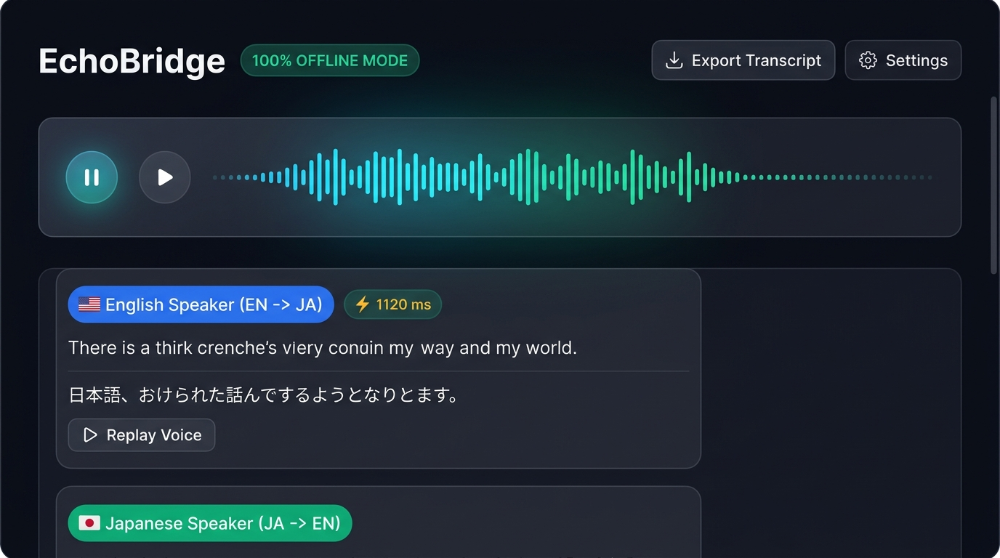

# 🌉 EchoBridge — Zero-Cost Offline Real-Time Speech Translator



EchoBridge is a lightweight, bidirectional, real-time speech-to-speech translator. It operates **100% offline on local hardware** with zero external cloud APIs, zero subscriptions, and complete privacy.

---

## 🚀 Key Highlights

- **✨ Dual Operational Modes:**
  - **Live Translation Mode (Bilingual):** Automatic vice-versa detection (`en` ⇄ `ja`) translating spoken speech in real-time without manual direction swapping.
  - **🎓 AI Language Coach & Tutor Mode:** Interactive spoken conversation partner. The assistant listens to your spoken Japanese or English, replies aloud in the target language to continue the dialogue, and provides real-time coaching cards explaining grammar corrections, missing particles/articles, politeness levels, and vocabulary idioms.
- **⚡ Ultra-Low Latency (<1.5s):** Sub-second end-to-end pipeline (VAD ➔ Faster-Whisper INT8 ➔ MarianMT / Coach Engine ➔ Piper TTS).
- **🧠 Hybrid AI Architecture:** 100% offline rule-based heuristic evaluator (<1ms, 0MB RAM) with optional fallback to local Ollama (`qwen2.5:0.5b`/`llama3.2`) or custom cloud endpoints.
- **🎛️ Dynamic 36-Band Soundwave Visualizer:** Organic real-time audio spectrum with decay physics and multi-color gradients.
- **💬 Glassmorphic Coaching & Chat Cards:** Politeness level tags (`丁寧語` / `敬語` / `Formal`), accuracy status pills (`✓ Natural` vs `⚡ Grammar Tip`), particle breakdown, inline `▶ Replay Voice`, and `📋 Copy Feedback`.
- **🪟 Floating Subtitle Overlay (HUD Mode):** Frameless, transparent, draggable always-on-top window that displays live subtitles over Zoom, YouTube, or games (`Ctrl+H`).
- **📥 Transcript Export:** Export complete session history with linguistic grammar coaching notes to plain text (`.txt`) or structured JSON (`.json`).
- **📱 Android Mobile Ready:** Flutter mobile app (`mobile/`) powered by Sherpa-ONNX with automated cloud CI/CD (`.github/workflows/build_apk.yml`).
- **📦 Portable Windows Executable:** Standalone `dist/EchoBridge.exe` bundling all models and runtimes for one-click launch without Python.

---

## 🏗️ Neural Pipeline Architecture

```
                    Microphone Input (16kHz PCM)
                                │
                                ▼
               Silero VAD v5 ONNX (~0.24ms frame chunk)
                                │
                                ▼
          Faster-Whisper Multilingual INT8 (~350–700ms)
                                │
                     Language Auto-Detection
                     ┌──────────┴──────────┐
               [English Spoken]      [Japanese Spoken]
                     │                     │
                     ▼                     ▼
          Argos / MarianMT EN➔JA   Argos / MarianMT JA➔EN
                   (~55ms)                (~52ms)
                     └──────────┬──────────┘
                                │
                                ▼
                 Piper VITS ONNX Audio Synthesis
              (Amy Low ~75ms | Hi-Fi Captain ~240ms)
                                │
                                ▼
                  Anti-Feedback Gated Playback
```

---

## ⌨️ Desktop Keyboard Shortcuts

| Shortcut | Action | Description |
|---|---|---|
| <kbd>Ctrl</kbd> + <kbd>Space</kbd> | **Toggle Listening** | Start or stop continuous microphone listening |
| <kbd>Ctrl</kbd> + <kbd>H</kbd> | **Subtitle Overlay (HUD)** | Switch to compact floating always-on-top subtitle window |
| <kbd>Ctrl</kbd> + <kbd>E</kbd> | **Export Transcript** | Save formatted conversation history to `.txt` |
| <kbd>Ctrl</kbd> + <kbd>Shift</kbd> + <kbd>C</kbd> | **Clear History** | Reset conversation stream and memory |
| <kbd>Ctrl</kbd> + <kbd>M</kbd> | **Toggle Mute** | Mute / unmute speaker voice playback |
| <kbd>F1</kbd> | **Settings** | Configure input/output audio devices and VAD sensitivity |

---

## 📊 Measured Latency Benchmarks (Intel Core i5-10310U CPU)

*Benchmarked on Intel Core i5 quad-core CPU, AVX2 enabled, no discrete GPU:*

| Pipeline Component | Neural Model | Latency | Memory Footprint |
|---|---|---|---|
| **VAD** | Silero VAD v5 ONNX | **0.24 ms** | ~2.3 MB |
| **STT** | Faster-Whisper Base INT8 | **690 – 1,120 ms** | ~145 MB |
| **STT (Fast Mode)** | Faster-Whisper Tiny INT8 | **250 – 380 ms** | ~39 MB |
| **MT (EN ➔ JA)** | MarianMT CTranslate2 INT8 | **55 – 74 ms** | ~45 MB |
| **MT (JA ➔ EN)** | MarianMT CTranslate2 INT8 | **52 – 60 ms** | ~45 MB |
| **TTS (English)** | Piper `en_US-amy-low` | **72 – 140 ms** | ~60 MB |
| **TTS (Japanese)** | Piper `ja_JP-hi_fi_captain` | **240 – 300 ms** | ~73 MB |
| **Total End-to-End** | **Audio In ➔ Audio Out** | **~850 – 1,400 ms** | **~420 MB Peak** |

---

## 💻 Running on Windows

### Option 1: Run via Python Virtual Environment
```powershell
# 1. Clone repository
git clone https://github.com/SivaGaneshv1729/echobridge-translator.git
cd echobridge-translator

# 2. Activate virtual environment & run
.\.venv\Scripts\activate
python app.py
```

### Option 2: Run Standalone Executable (No Python Required)
1. Download or extract `EchoBridge-Windows-Portable.zip`.
2. Double-click `EchoBridge.exe`.

### Build Standalone Executable Locally
```powershell
python scripts/build_desktop_exe.py
```

---

## 📱 EchoBridge Mobile (Android APK)

The mobile companion app is built with Flutter and Sherpa-ONNX under [`mobile/`](mobile/):

### Features:
- 100% on-device offline inference (ARM64-v8a).
- Dynamic 32-band reactive equalizer widget.
- Interactive transcript export modal (copy to clipboard, save `.txt`, export `.json`).
- Offline model cache verification and management.

### Build Android APK via GitHub Actions CI (Recommended):
Push any tag or manually trigger the workflow under **Actions** ➔ **Build Offline EchoBridge Android APK** on GitHub. The signed `.apk` will be compiled on cloud Ubuntu runners and uploaded to Releases.

### Build Android APK Locally:
```bash
cd mobile
flutter pub get
flutter build apk --release --split-per-abi
```

---

## 🧪 Automated Testing

Run the full pytest suite (17/17 tests passing):
```powershell
pytest -v
```

---

## 📜 License
Licensed under the [MIT License](LICENSE).
